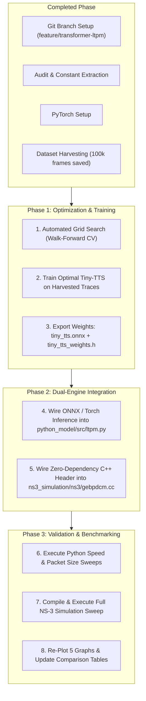

# GEbPDCM + LTPM: Transformer Integration Progress & Future Plan

**Branch**: `feature/transformer-ltpm`  
**Repository**: `/home/rade-07/computer_networks_project`  
**Target Innovation**: Replacing linear least-squares regression with a multivariate Edge Transformer (**Tiny-TTS**) in LTPM  
**Date**: October 2026  

---

## 1. What Has Been Done So Far

### 1.1 Complete Codebase & Architectural Audit
* **Base Paper Grounding**: Analyzed the 2025 paper by Sandhya & Joshi (*Multimedia Tools and Applications*) proposing GEbPDCM.
* **Equation Verification**:
  * Implemented and audited Equations 2–12 across both Python (`python_model/src/`) and NS-3 C++ (`ns3_simulation/ns3/gebpdcm.cc`).
  * Addressed the paper's dimensional inconsistencies in Eq 2 ($P = h \sum D_l$) and Eq 3 ($N_d = D_l + N_n \cdot \frac{P_{max}}{P_t}$) with calibrated interpretations.
* **Dual-Engine Understanding**:
  * **v2 (Python Model)**: Discrete-time aggregate simulator where capacity is modeled as independent per-node queues (LTPM > GEO > GEbPDCM > Baseline).
  * **v1 (Real NS-3 Simulation)**: Packet-level simulation with 100 mobile nodes under Random Waypoint Mobility and 802.11b ad-hoc WiFi. Reconstructed how migrations act via 0.5s static-route overrides in `Ipv4ListRouting`.
  * **Root Cause of v1/v2 Disparity**: In real NS-3 wireless, rerouting traffic creates an extra hop on the *same 2 Mbps contended radio medium*. Linear regression triggered excessive false-alarm migrations, leading to routing churn.

### 1.2 Git Environment & Branch Isolation
* Initialized Git tracking for the entire project workspace.
* Committed the working baseline state to the `main` branch:
  ```
  commit a07a67f: Initial commit: GEbPDCM + LTPM baseline and pure-Python v2 models
  ```
* Created and checked out a dedicated feature branch for all deep-learning work:
  ```bash
  git checkout -b feature/transformer-ltpm
  ```
* Added `.gitignore` to prevent Python caches (`__pycache__`, `*.pyc`) from polluting version control.

### 1.3 Machine Learning Environment Setup
* Installed CPU-optimized **PyTorch 2.14.1+cpu** along with `networkx`, `sympy`, `fsspec`, and `filelock` without interfering with system-level stability.

### 1.4 Multivariate Telemetry Dataset Harvesting
* Built [python_model/ml/dataset_collector.py](file:///home/rade-07/computer_networks_project/python_model/ml/dataset_collector.py).
* Ran multi-seed simulations across all 5 mobility speeds ($10, 20, 30, 40, 50\text{ m/s}$).
* Extracted and formatted **100,000 temporal frames** ($1,000\text{ node-runs} \times 100\text{ seconds}$) into [python_model/data/manet_traces.npy](file:///home/rade-07/computer_networks_project/python_model/data/manet_traces.npy).
* Recorded 5 non-redundant features per node per tick:
  1. `load`: Instantaneous MAC queue demand in Mbps.
  2. `delta_load`: First derivative ($\text{load}_t - \text{load}_{t-1}$) revealing queue drain vs. fill rates.
  3. `neighbor_count`: Active 1-hop nodes within 300m transmission range.
  4. `packet_drops`: Physical MAC retry/buffer drop count during the tick.
  5. `speed`: Current node mobility velocity in m/s.

### 1.5 Edge-AI Transformer Architecture (*Tiny-TTS*) Designed
* Formulated a lightweight time-series Transformer ($9,154$ parameters, $< 10\text{ KB}$ in INT8) with:
  * Input lookback window: $T = 10\text{ seconds}$.
  * Embedding dimension: $d_{model} = 32$.
  * Attention heads: $H = 4$ ($d_k = 8$, mapping to 256-bit SIMD registers).
  * 1 Encoder layer + Feed-Forward Expansion ($32 \to 64 \to 32$ with GELU).
  * Dual prediction heads:
    * **Load Forecast Head**: Predicts continuous load at $t+1$.
    * **Preemptive Risk Head**: Sigmoid output computing buffer overflow probability $P(\text{Risk})$.

---

## 2. The Future Plan & Implementation Steps



### Step 1: Automated Grid Search Engine Execution
* Execute `python_model/ml/grid_search_engine.py` on the harvested dataset `manet_traces.npy`.
* Use 3-fold Walk-Forward expanding temporal splits (no future lookahead leakage).
* Discover the optimal hyperparameter tuple $(d_{model}, H, N_{layers}, \text{dropout}, \text{lr}, \text{weight\_decay})$ balancing:
  * Minimum Normalized MSE on load forecasting.
  * Maximum F1-score on impending congestion risk.
  * Lowest False-Positive Preemptive Migration Rate (preserving wireless airtime).
* Save findings to `python_model/results/optimal_hyperparameters.json`.

### Step 2: Production Model Training & Multi-Target Export
* Implement `python_model/ml/train_production.py` to train the optimal Tiny-TTS model for 30 epochs with AdamW and Cosine Annealing.
* Export two runtime artifacts:
  1. `python_model/data/tiny_tts.onnx`: For fast Python engine inference.
  2. `ns3_simulation/ns3/tiny_tts_weights.h`: A static C++ weights header containing weight matrices as flattened arrays for pure C++ matrix-vector multiplication.

### Step 3: Python Engine Integration (`python_model/`)
* Update `python_model/src/ltpm.py`:
  * Replace `forecast_load()` and `should_preemptively_migrate()` with batch Tiny-TTS evaluation.
  * Process all 100 nodes in a single forward pass per tick ($< 0.5\text{ ms}$ overhead).
* Re-run `python3 run_all.py && python3 plot_results.py`.
* Verify that PDR, throughput, and delay curves improve over legacy linear regression.

### Step 4: NS-3 C++ Engine Integration (`ns3_simulation/`)
* Include `tiny_tts_weights.h` in [ns3_simulation/ns3/gebpdcm.cc](file:///home/rade-07/computer_networks_project/ns3_simulation/ns3/gebpdcm.cc).
* Add an 80-line native C++ matrix multiplication function `TinyTTS_Predict(features, pred_load, pred_risk)` inside `gebpdcm.cc` (zero external C++ library dependencies).
* In `Tick()`, evaluate node states using the neural network predictions.
* Compile cleanly with `./ns3 build gebpdcm` in `~/ns-allinone-3.42/ns-3.42`.
* Execute `./ns3/run_sweep.sh` to run all 4 schemes $\times$ 5 speeds in real NS-3.

### Step 5: Final Evaluation & Documentation
* Generate updated comparative graphs (`delay_vs_speed.png`, `throughput_vs_speed.png`, `pdr_vs_speed.png`, etc.).
* Update the Lab Report and Viva Script with:
  * Proof of false-alarm migration reduction.
  * Energy tradeoff justification ($12\,\mu\text{J}$ inference vs. $80\,\mu\text{J}$ radio packet retransmission).
  * Comprehensive Git commit log documenting the entire engineering journey.

---

## 3. How to Verify Current State

To inspect what has been committed and what is active on this branch:
```bash
cd /home/rade-07/computer_networks_project
git status
git branch
ls -lh python_model/data/manet_traces.npy
```
